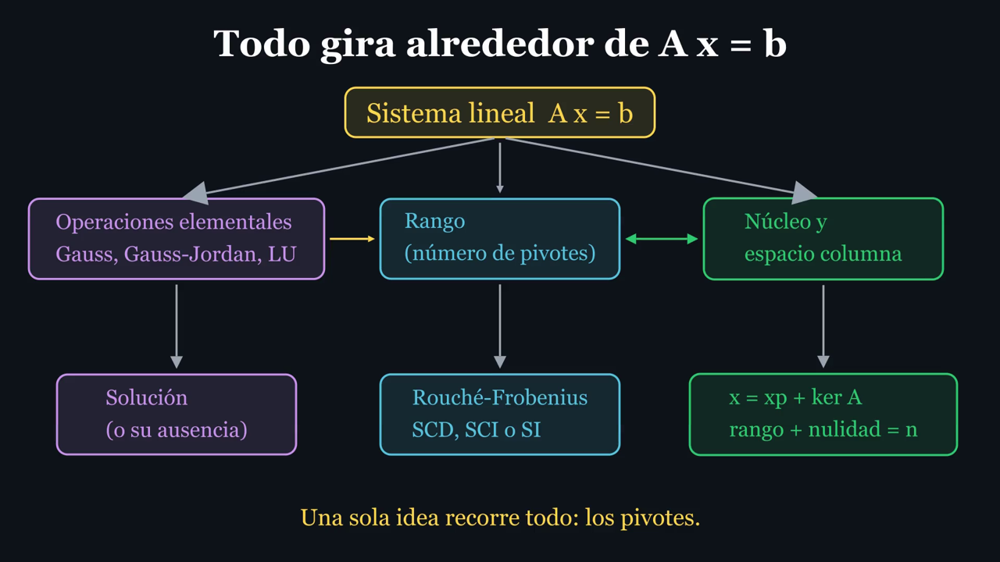
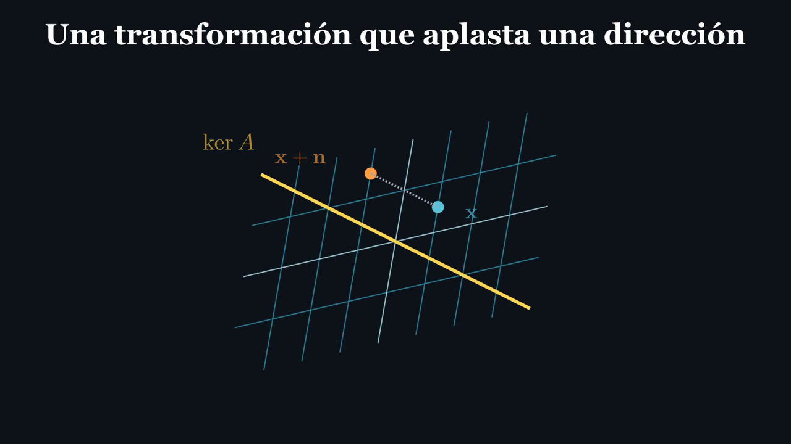
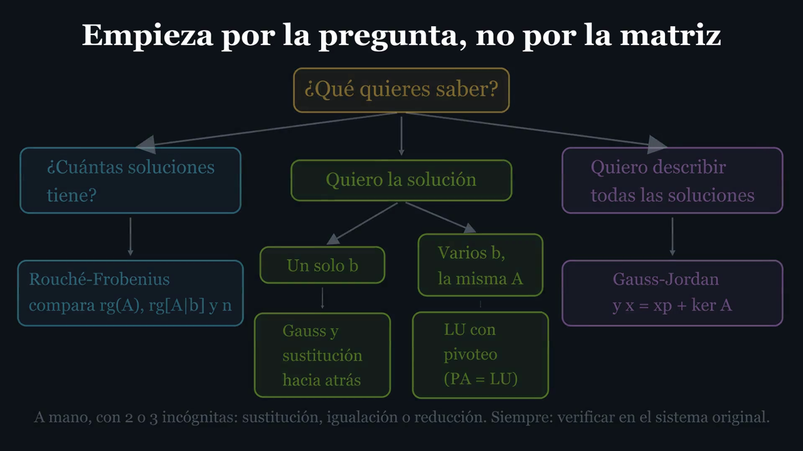
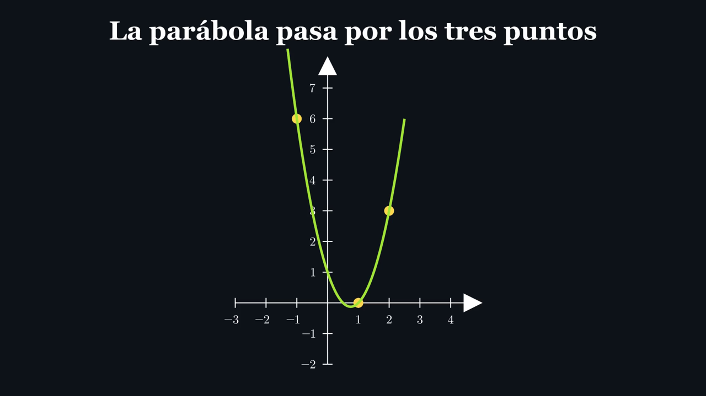

<div align="center">

# Álgebra lineal, vista y comprendida

**Un curso universitario de sistemas de ecuaciones lineales, explicado desde cero con animaciones, voz y 665 ejercicios resueltos.**




*El mapa del curso (video L55): todo gira alrededor de $A\mathbf{x} = \mathbf{b}$, y los pivotes lo conectan todo.*

</div>

---

## La idea en cuatro líneas

Un sistema lineal $A\mathbf{x} = \mathbf{b}$ puede no tener solución, tener una o tener infinitas. Este curso enseña a **decidirlo, resolverlo y describirlo**, con una sola herramienta: los pivotes.

$$\boxed{\,A\mathbf{x} = \mathbf{b}\ \text{es compatible} \iff \operatorname{rg}(A) = \operatorname{rg}[A \mid \mathbf{b}]\,}\qquad\text{(Rouché-Frobenius)}$$

$$\operatorname{rg}(A) + \operatorname{nul}(A) = n \qquad\qquad \mathbf{x} = \mathbf{x}_p + \ker A \qquad\qquad A = LU$$

## Qué contiene

| Unidad | Tema | Lecciones | Videos |
|---|---|---|---|
| 0 | Preliminares | L00–L04 | 16 |
| 1 | Fundamentos de las ecuaciones lineales | L05–L12 | 24 |
| 2 | Métodos elementales: sustitución, igualación, reducción | L13–L15 | 8 |
| 3 | Matrices, vectores y $A\mathbf{x} = \mathbf{b}$ | L16–L23 | 18 |
| 4 | Eliminación de Gauss | L24–L30 | 14 |
| 5 | Gauss-Jordan | L31–L33 | 7 |
| 6 | Factorización $LU$ y $PA = LU$ | L34–L38 | 13 |
| 7 | Rango y teorema de Rouché-Frobenius | L39–L42 | 10 |
| 8 | Núcleo, espacio columna y rango-nulidad | L43–L50 | 17 |
| 9 | Síntesis: elegir método, problemas integradores, demostraciones | L51–L55 | 15 |

Cada video lleva **voz en español** (voz neuronal sintética) y **subtítulos `.srt`**, y termina con un ejercicio propuesto. Además:

- **665 ejercicios** en 17 familias y 5 niveles, con pistas progresivas y solución justificada (`ejercicios/`, índice en `ejercicios/BANCO.md`).
- **Solucionario completo** (`solucionario/`), **formulario** y **árbol de decisión de métodos** (`material/`), **plan de estudio de 12 semanas** y una **prueba final integradora** de 2 horas y 100 puntos (`prueba_final/`).
- Todos los resultados numéricos están **comprobados con aritmética exacta** (fracciones, nunca decimales redondeados) y los ejercicios generados se contrastan con SymPy.

## Un vistazo

<table>
<tr>
<td width="50%"><br><sub><b>Rango y nulidad.</b> Una matriz aplasta su núcleo al origen y la imagen sobrevive: 1 + 1 = 2.</sub></td>
<td width="50%"><br><sub><b>Elegir el método.</b> Primero la pregunta, después la herramienta.</sub></td>
</tr>
<tr>
<td colspan="2" align="center"><br><sub><b>Problemas integradores.</b> Una parábola por tres puntos es un sistema $3 \times 3$ en sus coeficientes.</sub></td>
</tr>
</table>

## Las ideas que recorre el curso

1. Una ecuación lineal es una recta, un plano o un hiperplano; un sistema tiene $0$, $1$ o infinitas soluciones.
2. Las operaciones elementales no cambian las soluciones: **Gauss** escalona, **Gauss-Jordan** reduce, **$LU$** factoriza una vez y resuelve muchas.
3. El **rango** es el número de pivotes y decide la clasificación (**Rouché-Frobenius**).
4. La solución general es una particular más el **núcleo**, y $A\mathbf{x} = \mathbf{b}$ tiene solución si y solo si $\mathbf{b}$ está en el **espacio columna**.

## Cómo estudiar

1. Sigue el [plan de estudio de 12 semanas](material/plan_de_estudio.md).
2. Ve cada video sin tomar apuntes, haz su ejercicio propuesto y practica con el [banco de ejercicios](ejercicios/BANCO.md); comprueba en el [solucionario](solucionario/README.md).
3. Repasa con el [formulario](material/formulario.md) y los [métodos](material/metodos.md).
4. Al final, la [prueba final](prueba_final/PRUEBA_FINAL.md) y su [solución](prueba_final/SOLUCION_PRUEBA_FINAL.md).

## Ver los videos en una plataforma web (sin abrir carpetas)

La carpeta [`plataforma/`](plataforma/) es una web local que reúne los videos por unidades y lecciones, con subtítulos, guiones, ejercicios, progreso y búsqueda. Requiere Node 18 o superior:

```
git clone https://github.com/Joel-S-Florian/curso-algebra-lineal.git
cd curso-algebra-lineal/plataforma
npm install
npm start
```

Luego abre `http://127.0.0.1:5173`. Detalles en [`plataforma/README.md`](plataforma/README.md).

## Regenerar los videos (opcional)

Los videos ya están en `videos/` (carpeta `1080p60`). Para regenerarlos hacen falta Python 3.13, [Manim Community](https://www.manim.community/) 0.22 y LaTeX (MiKTeX): ver [`docs/02_plan_tecnico.md`](docs/02_plan_tecnico.md). Las escenas están en `escenas/` y la narración, en el propio código de cada escena.

---

## Índice de videos y archivos del curso

## Dónde está cada cosa

| Quiero… | Abro… |
|---|---|
| **Ver los videos** | `videos\<lección>\1080p60\<Escena>.mp4` (tabla de abajo) |
| Ver el mapa del curso | `docs\01_diseno_curso.md` |
| Instalar / renderizar | `docs\02_plan_tecnico.md` |
| Leer la teoría y el guion de una lección | `guiones\lNN_nombre.md` |
| Hacer ejercicios (pistas y soluciones plegadas) | `ejercicios\F00_preliminares.md` (Unidad 0); `F01_…`, `F02_…`, `F03_…` (Unidad 1); `F04_…` (Unidad 2); `F05_…`–`F07_…` (Unidad 3); `F08_gauss.md` (Unidad 4); `F09_gauss_jordan.md` (Unidad 5); `F10_factorizacion_lu.md` (Unidad 6); `F11_rango_rouche_frobenius.md` (Unidad 7); `F12_combinaciones_independencia_base.md`, `F13_nucleo.md`, `F14_espacio_columna_imagen.md` (Unidad 8) |
| **Practicar más** (la parte 2 de cada familia; 665 ejercicios en total) | `ejercicios\BANCO.md` (índice de todo) y `ejercicios\Fnn_..._parte2.md` |
| Comprobar mis respuestas | `solucionario\README.md` y `solucionario\Fnn.md` (solución completa de cada ejercicio) |
| Organizarme | `material\plan_de_estudio.md` (12 semanas, con qué ver y hacer cada una) |
| Repasar de un vistazo | `material\formulario.md` (conceptos y teoremas) |
| Elegir un método | `material\metodos.md` (tabla comparativa y árbol de decisión) |
| Evaluarme | `prueba_final\PRUEBA_FINAL.md` (2 horas, 100 puntos) y `prueba_final\SOLUCION_PRUEBA_FINAL.md` |
| Comprobar las soluciones numéricas | `python ejercicios\verificar\f00.py`, `f01_f03.py`, `f04.py`, `f05_f07.py`, `f08.py`, `f09.py`, `f10.py`, `f11.py`, `f12_f14.py`, `unidad9.py` y `parte2.py` |
| Regenerar bancos, solucionario y prueba | `python ejercicios\generar\generar.py`, luego `python ejercicios\generar\banco_y_solucionario.py` y `python prueba_final\generar_prueba.py` |

## Videos disponibles (1920×1080, 60 fps)

Orden de estudio recomendado: de arriba abajo. Después de cada video, haz su ejercicio propuesto.

| Lección | Video | Duración |
|---|---|---|
| L00 Prueba del entorno | `videos\l00_prueba_entorno\1080p60\PruebaEntorno.mp4` | 2:31 |
| **Unidad 0 — Preliminares** | | |
| L01 · 1 Conjuntos numéricos | `videos\l01_numeros_reales\1080p60\ConjuntosNumericos.mp4` | 2:54 |
| L01 · 2 Reglas de los signos | `videos\l01_numeros_reales\1080p60\ReglasDeSignos.mp4` | 2:32 |
| L01 · 3 Fracciones | `videos\l01_numeros_reales\1080p60\Fracciones.mp4` | 2:40 |
| L01 · 4 Propiedades de las operaciones | `videos\l01_numeros_reales\1080p60\PropiedadesDeLasOperaciones.mp4` | 3:01 |
| L02 · 1 Variables, términos y coeficientes | `videos\l02_expresiones_ecuaciones\1080p60\VariableIncognitaCoeficiente.mp4` | 3:12 |
| L02 · 2 Igualdades y ecuaciones | `videos\l02_expresiones_ecuaciones\1080p60\QueEsUnaEcuacion.mp4` | 2:11 |
| L02 · 3 Transformar sin cambiar soluciones | `videos\l02_expresiones_ecuaciones\1080p60\TransformacionesQueConservanSoluciones.mp4` | 2:59 |
| L03 · 1 Plano cartesiano | `videos\l03_coordenadas\1080p60\ParesOrdenados.mp4` | 1:55 |
| L03 · 2 La gráfica de una ecuación | `videos\l03_coordenadas\1080p60\GraficaComoConjuntoDePuntos.mp4` | 1:47 |
| L03 · 3 Pendiente y forma ax + by = c | `videos\l03_coordenadas\1080p60\PendienteDeUnaRecta.mp4` | 2:40 |
| L03 · 4 El espacio de tres coordenadas | `videos\l03_coordenadas\1080p60\EspacioTresCoordenadas.mp4` | 1:54 |
| L04 · 1 Conjuntos | `videos\l04_lenguaje_matematico\1080p60\ConjuntosYPertenencia.mp4` | 2:23 |
| L04 · 2 Subíndices y sumatorios | `videos\l04_lenguaje_matematico\1080p60\SubindicesYSumatorio.mp4` | 2:40 |
| L04 · 3 Implicación y equivalencia | `videos\l04_lenguaje_matematico\1080p60\ImplicacionYEquivalencia.mp4` | 2:34 |
| L04 · 4 ¿Cómo se demuestra algo? | `videos\l04_lenguaje_matematico\1080p60\ComoSeDemuestraAlgo.mp4` | 2:36 |
| **Unidad 1 — Fundamentos de ecuaciones lineales** | | |
| L05 · 1 Definición de ecuación lineal | `videos\l05_ecuacion_lineal\1080p60\DefinicionEcuacionLineal.mp4` | 2:12 |
| L05 · 2 Lineal o no lineal | `videos\l05_ecuacion_lineal\1080p60\LinealVsNoLineal.mp4` | 1:56 |
| L05 · 3 Trampas de linealidad | `videos\l05_ecuacion_lineal\1080p60\TrampasDeLinealidad.mp4` | 2:29 |
| L06 · 1 Despeje justificado | `videos\l06_una_incognita\1080p60\DespejeJustificado.mp4` | 3:08 |
| L06 · 2 ax = b: los tres casos | `videos\l06_una_incognita\1080p60\LosTresCasos.mp4` | 2:15 |
| L07 · 1 Infinitas soluciones de una ecuación | `videos\l07_dos_y_tres_incognitas\1080p60\InfinitasSolucionesDeUnaEcuacion.mp4` | 1:56 |
| L07 · 2 ax + by = c es una recta | `videos\l07_dos_y_tres_incognitas\1080p60\EcuacionComoRecta.mp4` | 1:52 |
| L07 · 3 ax + by + cz = d es un plano (3D) | `videos\l07_dos_y_tres_incognitas\1080p60\EcuacionComoPlano.mp4` | 1:32 |
| L07 · 4 Parámetros | `videos\l07_dos_y_tres_incognitas\1080p60\ParametrizarUnaRecta.mp4` | 1:57 |
| L08 · 1 ¿Qué es un sistema? | `videos\l08_sistemas_2x2\1080p60\QueEsUnSistema.mp4` | 2:34 |
| L08 · 2 Rectas que se cortan | `videos\l08_sistemas_2x2\1080p60\RectasQueSeCortan.mp4` | 2:14 |
| L08 · 3 Rectas paralelas | `videos\l08_sistemas_2x2\1080p60\RectasParalelas.mp4` | 1:59 |
| L08 · 4 Rectas coincidentes | `videos\l08_sistemas_2x2\1080p60\RectasCoincidentes.mp4` | 2:05 |
| L09 · 1 Tres planos, un punto (3D) | `videos\l09_sistemas_3x3\1080p60\TresPlanosUnPunto.mp4` | 1:53 |
| L09 · 2 Tres planos, una recta (3D) | `videos\l09_sistemas_3x3\1080p60\TresPlanosUnaRecta.mp4` | 1:57 |
| L09 · 3 Tres planos sin punto común (3D) | `videos\l09_sistemas_3x3\1080p60\TresPlanosSinPuntoComun.mp4` | 2:00 |
| L10 · 1 Notación general m × n | `videos\l10_sistemas_mxn\1080p60\NotacionGeneral.mp4` | 2:04 |
| L10 · 2 Hiperplanos y límites del dibujo | `videos\l10_sistemas_mxn\1080p60\HiperplanosYLimitesDelDibujo.mp4` | 1:55 |
| L10 · 3 Sistemas homogéneos | `videos\l10_sistemas_mxn\1080p60\SistemasHomogeneos.mp4` | 1:54 |
| L11 · 1 Clasificación: SCD, SCI, SI | `videos\l11_clasificacion\1080p60\ClasificacionDeSistemas.mp4` | 1:58 |
| L11 · 2 Nunca exactamente dos soluciones | `videos\l11_clasificacion\1080p60\NuncaExactamenteDos.mp4` | 2:25 |
| L12 · 1 Más ecuaciones que incógnitas | `videos\l12_casos_especiales\1080p60\MasEcuacionesQueIncognitas.mp4` | 1:57 |
| L12 · 2 Menos ecuaciones que incógnitas (3D) | `videos\l12_casos_especiales\1080p60\MenosEcuacionesQueIncognitas.mp4` | 1:40 |
| L12 · 3 Errores frecuentes | `videos\l12_casos_especiales\1080p60\ErroresFrecuentesBloqueI.mp4` | 2:07 |
| **Unidad 2 — Métodos elementales** | | |
| L13 · 1 Sustitución paso a paso | `videos\l13_sustitucion\1080p60\SustitucionPasoAPaso.mp4` | 2:40 |
| L13 · 2 ¿Cuándo conviene sustituir? | `videos\l13_sustitucion\1080p60\SustitucionCuandoConviene.mp4` | 2:04 |
| L13 · 3 Cuando la incógnita desaparece | `videos\l13_sustitucion\1080p60\SustitucionCasosEspeciales.mp4` | 2:27 |
| L14 · 1 Igualación paso a paso | `videos\l14_igualacion\1080p60\IgualacionPasoAPaso.mp4` | 2:04 |
| L14 · 2 Igualar es buscar la misma altura | `videos\l14_igualacion\1080p60\IgualacionInterpretacion.mp4` | 2:18 |
| L15 · 1 Reducción paso a paso | `videos\l15_reduccion\1080p60\ReduccionPasoAPaso.mp4` | 2:15 |
| L15 · 2 Por qué reducir conserva las soluciones | `videos\l15_reduccion\1080p60\PorQueReduccionConservaSoluciones.mp4` | 2:45 |
| L15 · 3 ¿Qué método elegir? | `videos\l15_reduccion\1080p60\ComparacionDeMetodos.mp4` | 2:18 |
| **Unidad 3 — Matrices y Ax = b** | | |
| L16 · 1 ¿Qué es una matriz? | `videos\l16_matrices\1080p60\QueEsUnaMatriz.mp4` | |
| L16 · 2 Tipos de matrices | `videos\l16_matrices\1080p60\TiposDeMatrices.mp4` | |
| L17 · 1 ¿Qué es un vector? | `videos\l17_vectores\1080p60\VectorComoFlechaYComoPunto.mp4` | |
| L17 · 2 Suma y escalar | `videos\l17_vectores\1080p60\SumaYEscalarGeometricos.mp4` | |
| L17 · 3 Combinaciones lineales | `videos\l17_vectores\1080p60\PrimeraCombinacionLineal.mp4` | |
| L18 · 1 Suma de matrices | `videos\l18_suma_y_escalar\1080p60\SumaDeMatrices.mp4` | |
| L18 · 2 Escalar y propiedades | `videos\l18_suma_y_escalar\1080p60\ProductoPorEscalarYPropiedades.mp4` | |
| L19 · 1 Fila por columna | `videos\l19_matriz_por_vector\1080p60\FilaPorColumna.mp4` | |
| L19 · 2 Combinación de columnas | `videos\l19_matriz_por_vector\1080p60\ComoCombinacionDeColumnas.mp4` | |
| L20 · 1 Producto de matrices | `videos\l20_producto_matricial\1080p60\DimensionesYProcedimiento.mp4` | |
| L20 · 2 AB y BA, identidad | `videos\l20_producto_matricial\1080p60\NoConmutatividadEIdentidad.mp4` | |
| L21 · 1 La rejilla se deforma | `videos\l21_transformaciones\1080p60\LaRejillaSeDeforma.mp4` | |
| L21 · 2 Las columnas y la base | `videos\l21_transformaciones\1080p60\ColumnasSonImagenesDeLaBase.mp4` | |
| L21 · 3 ¿Qué significa lineal? | `videos\l21_transformaciones\1080p60\QueSignificaLineal.mp4` | |
| L22 · 1 Construir Ax = b | `videos\l22_forma_matricial\1080p60\ConstruirAxb.mp4` | |
| L22 · 2 Ax reproduce el sistema | `videos\l22_forma_matricial\1080p60\AxReproduceLasEcuaciones.mp4` | |
| L23 · 1 Matriz aumentada | `videos\l23_matriz_aumentada\1080p60\SistemaAMatrizAumentada.mp4` | |
| L23 · 2 Sistemas equivalentes | `videos\l23_matriz_aumentada\1080p60\SistemasEquivalentes.mp4` | |
| **Unidad 4 — Eliminación de Gauss** | | |
| L24 · 1 Las tres operaciones elementales | `videos\l24_operaciones_elementales\1080p60\OperacionesElementales.mp4` | 3:56 |
| L24 · 2 Cada operación se puede deshacer | `videos\l24_operaciones_elementales\1080p60\CadaOperacionSeDeshace.mp4` | 3:02 |
| L25 · 1 Forma escalonada y pivotes | `videos\l25_forma_escalonada\1080p60\FormaEscalonadaYPivotes.mp4` | 3:07 |
| L25 · 2 La forma escalonada no es única | `videos\l25_forma_escalonada\1080p60\LaEscalonadaNoEsUnica.mp4` | 2:15 |
| L26 · 1 Gauss en un sistema 2 × 2 | `videos\l26_eliminacion_gauss\1080p60\GaussDosPorDos.mp4` | 3:23 |
| L26 · 2 Gauss en un sistema 3 × 3 | `videos\l26_eliminacion_gauss\1080p60\GaussTresPorTres.mp4` | 3:15 |
| L27 · 1 Cuando el pivote vale 0 | `videos\l27_pivotes_nulos\1080p60\PivoteCeroIntercambio.mp4` | 3:31 |
| L27 · 2 Filas nulas y ecuaciones redundantes | `videos\l27_pivotes_nulos\1080p60\FilaNulaEcuacionRedundante.mp4` | 3:17 |
| L28 · 1 Cuando aparece 0 = c | `videos\l28_sin_solucion_e_infinitas\1080p60\FilaContradictoria.mp4` | 2:49 |
| L28 · 2 Variables libres y solución paramétrica | `videos\l28_sin_solucion_e_infinitas\1080p60\VariablesLibresYSolucionParametrica.mp4` | 3:21 |
| L29 · 1 Gauss con un parámetro | `videos\l29_sistemas_con_parametros\1080p60\GaussConParametro.mp4` | 3:01 |
| L29 · 2 Discutir por casos | `videos\l29_sistemas_con_parametros\1080p60\DiscutirPorCasos.mp4` | 2:58 |
| L30 · 1 Errores frecuentes en Gauss | `videos\l30_errores_frecuentes\1080p60\ErroresFrecuentesGauss.mp4` | 3:04 |
| L30 · 2 Verificar siempre | `videos\l30_errores_frecuentes\1080p60\VerificarSiempre.mp4` | 2:26 |
| **Unidad 5 — Gauss-Jordan** | | |
| L31 · 1 De la escalonada a la reducida | `videos\l31_escalonada_reducida\1080p60\DeEscalonadaAReducida.mp4` | 2:36 |
| L31 · 2 Gauss-Jordan paso a paso | `videos\l31_escalonada_reducida\1080p60\EliminarArribaYAbajo.mp4` | 3:14 |
| L31 · 3 La reducida es única | `videos\l31_escalonada_reducida\1080p60\LaReducidaEsUnica.mp4` | 3:03 |
| L32 · 1 Leer la solución | `videos\l32_basicas_y_libres\1080p60\LeerLaSolucion.mp4` | 2:58 |
| L32 · 2 Tres finales posibles | `videos\l32_basicas_y_libres\1080p60\TresFinalesPosibles.mp4` | 2:41 |
| L33 · 1 Contar operaciones | `videos\l33_gauss_frente_a_jordan\1080p60\ContarOperaciones.mp4` | 3:08 |
| L33 · 2 Cuándo conviene cada uno | `videos\l33_gauss_frente_a_jordan\1080p60\CuandoConvieneCadaUno.mp4` | 2:36 |
| **Unidad 6 — Factorización LU** | | |
| L34 · 1 Qué es factorizar | `videos\l34_factorizar_y_triangulares\1080p60\QueEsFactorizar.mp4` | 2:10 |
| L34 · 2 Triangulares y sustitución | `videos\l34_factorizar_y_triangulares\1080p60\TriangularesYSustitucion.mp4` | 2:20 |
| L34 · 3 Matrices elementales | `videos\l34_factorizar_y_triangulares\1080p60\MatricesElementales.mp4` | 2:43 |
| L35 · 1 Los multiplicadores se guardan | `videos\l35_de_donde_sale_lu\1080p60\LosMultiplicadoresSeGuardan.mp4` | 2:35 |
| L35 · 2 Construir L y U | `videos\l35_de_donde_sale_lu\1080p60\ConstruirLyU.mp4` | 2:38 |
| L36 · 1 Hacia adelante: L y = b | `videos\l36_resolver_con_lu\1080p60\SustitucionHaciaAdelanteLy.mp4` | 2:14 |
| L36 · 2 Hacia atrás: U x = y | `videos\l36_resolver_con_lu\1080p60\SustitucionHaciaAtrasUx.mp4` | 2:21 |
| L36 · 3 Ejemplo completo | `videos\l36_resolver_con_lu\1080p60\EjemploCompletoLU.mp4` | 2:59 |
| L37 · 1 Cuando LU falla | `videos\l37_permutaciones_pa_lu\1080p60\CuandoLUFalla.mp4` | 2:38 |
| L37 · 2 Matrices de permutación | `videos\l37_permutaciones_pa_lu\1080p60\MatricesDePermutacion.mp4` | 2:08 |
| L37 · 3 Pivoteo parcial | `videos\l37_permutaciones_pa_lu\1080p60\PivoteoParcial.mp4` | 3:20 |
| L38 · 1 Muchos lados derechos | `videos\l38_comparacion_y_aplicaciones\1080p60\MuchosLadosDerechos.mp4` | 3:07 |
| L38 · 2 Tabla comparativa | `videos\l38_comparacion_y_aplicaciones\1080p60\TablaComparativa.mp4` | 2:32 |
| **Unidad 7 — Rango y Rouché-Frobenius** | | |
| L39 · 1 El rango como número de pivotes | `videos\l39_rango\1080p60\RangoComoNumeroDePivotes.mp4` | 2:28 |
| L39 · 2 Rango de A y de la aumentada | `videos\l39_rango\1080p60\RangoDeAyDeAumentada.mp4` | 1:50 |
| L39 · 3 El rango no es el número de ecuaciones | `videos\l39_rango\1080p60\RangoNoEsNumeroDeEcuaciones.mp4` | 1:57 |
| L40 · 1 Enunciado | `videos\l40_rouche_frobenius\1080p60\EnunciadoRF.mp4` | 2:33 |
| L40 · 2 Demostración | `videos\l40_rouche_frobenius\1080p60\DemostracionRF.mp4` | 2:40 |
| L40 · 3 Incógnitas, rango y libres | `videos\l40_rouche_frobenius\1080p60\IncognitasRangoYLibres.mp4` | 2:10 |
| L41 · 1 Ejemplos clasificados | `videos\l41_clasificacion_con_ejemplos\1080p60\EjemplosClasificados.mp4` | 2:27 |
| L41 · 2 Árbol de decisión | `videos\l41_clasificacion_con_ejemplos\1080p60\ArbolDeDecision.mp4` | 2:16 |
| L42 · 1 Discusión con un parámetro | `videos\l42_discusion_con_parametros\1080p60\DiscusionConParametro.mp4` | 2:23 |
| L42 · 2 Clasificar sin resolver | `videos\l42_discusion_con_parametros\1080p60\ClasificarSinResolver.mp4` | 2:41 |
| **Unidad 8 — Núcleo e imagen** | | |
| L43 · 1 Combinaciones lineales | `videos\l43_combinaciones_y_generado\1080p60\CombinacionLinealGeometrica.mp4` | 2:30 |
| L43 · 2 El espacio generado | `videos\l43_combinaciones_y_generado\1080p60\EspacioGenerado.mp4` | 2:23 |
| L44 · 1 Dependencia e independencia | `videos\l44_independencia_base_dimension\1080p60\DependenciaLineal.mp4` | 2:17 |
| L44 · 2 Cómo comprobar la independencia | `videos\l44_independencia_base_dimension\1080p60\ComoComprobarIndependencia.mp4` | 2:35 |
| L44 · 3 Base y dimensión | `videos\l44_independencia_base_dimension\1080p60\BaseYDimension.mp4` | 2:31 |
| L45 · 1 El núcleo de una matriz | `videos\l45_el_nucleo\1080p60\DefinicionNucleo.mp4` | 2:55 |
| L45 · 2 ¿Está un vector en el núcleo? | `videos\l45_el_nucleo\1080p60\ComprobarSiUnVectorEstaEnElNucleo.mp4` | 2:18 |
| L46 · 1 Una base del núcleo | `videos\l46_base_y_nulidad\1080p60\VariablesLibresDanLaBase.mp4` | 3:00 |
| L46 · 2 La nulidad | `videos\l46_base_y_nulidad\1080p60\Nulidad.mp4` | 2:23 |
| L47 · 1 Una solución más el núcleo | `videos\l47_estructura_de_las_soluciones\1080p60\SolucionParticularMasNucleo.mp4` | 2:43 |
| L47 · 2 La recta trasladada | `videos\l47_estructura_de_las_soluciones\1080p60\RectaTrasladada.mp4` | 2:19 |
| L48 · 1 A x como combinación de columnas | `videos\l48_espacio_columna_e_imagen\1080p60\AxEsCombinacionDeColumnas.mp4` | 2:27 |
| L48 · 2 ¿Cuándo tiene solución A x = b? | `videos\l48_espacio_columna_e_imagen\1080p60\ExisteSolucionSiiBEnCol.mp4` | 2:36 |
| L49 · 1 Una base del espacio columna | `videos\l49_base_del_espacio_columna\1080p60\ColumnasPivote.mp4` | 2:16 |
| L49 · 2 ¿Por qué las de la original? | `videos\l49_base_del_espacio_columna\1080p60\PorQueEnLaMatrizOriginal.mp4` | 2:30 |
| L50 · 1 Lo que se pierde y lo que sobrevive | `videos\l50_rango_nulidad\1080p60\NucleoColapsaImagenSobrevive.mp4` | 2:08 |
| L50 · 2 Teorema del rango y la nulidad | `videos\l50_rango_nulidad\1080p60\DemostracionRangoNulidad.mp4` | 2:41 |
| **Unidad 9 — Síntesis** | | |
| L51 · 1 Árbol de decisión de métodos | `videos\l51_elegir_el_metodo\1080p60\ArbolDeDecisionDeMetodos.mp4` | 2:18 |
| L51 · 2 Pregunta y herramienta | `videos\l51_elegir_el_metodo\1080p60\PreguntaYHerramienta.mp4` | 1:56 |
| L52 · 1 Problema de mezclas | `videos\l52_problemas_integradores_1\1080p60\ProblemaMezclas.mp4` | 2:44 |
| L52 · 2 Flujo de una rotonda | `videos\l52_problemas_integradores_1\1080p60\ProblemaRotonda.mp4` | 2:44 |
| L52 · 3 Varios lados derechos con LU | `videos\l52_problemas_integradores_1\1080p60\ProblemaVariosLadosDerechos.mp4` | 2:22 |
| L52 · 4 Parábola por tres puntos | `videos\l52_problemas_integradores_1\1080p60\ProblemaParabola.mp4` | 2:39 |
| L53 · 1 Sistema con un parámetro | `videos\l53_problemas_integradores_2\1080p60\ProblemaConParametro.mp4` | 3:18 |
| L53 · 2 Núcleo, imagen y solución | `videos\l53_problemas_integradores_2\1080p60\ProblemaNucleoEImagen.mp4` | 2:34 |
| L53 · 3 Verdadero o falso | `videos\l53_problemas_integradores_2\1080p60\VerdaderoOFalso.mp4` | 2:38 |
| L54 · 1 Dos soluciones, infinitas soluciones | `videos\l54_demostraciones\1080p60\NoHayExactamenteDosSoluciones.mp4` | 1:57 |
| L54 · 2 Las operaciones conservan las soluciones | `videos\l54_demostraciones\1080p60\OperacionesConservanSoluciones.mp4` | 2:20 |
| L54 · 3 Demostraciones clave | `videos\l54_demostraciones\1080p60\DemostracionesClave.mp4` | 2:56 |
| L55 · 1 Mapa conceptual | `videos\l55_repaso_final\1080p60\MapaConceptual.mp4` | 2:40 |
| L55 · 2 Prueba integradora | `videos\l55_repaso_final\1080p60\PruebaIntegradora.mp4` | 2:00 |
| L55 · 3 Lo que sigue | `videos\l55_repaso_final\1080p60\LoQueSigue.mp4` | 1:06 |

**Voz**: todos los videos están narrados en español con voz sintética (Dalia, voz neuronal mexicana de Microsoft). Cada video trae al lado un archivo `.srt` con los subtítulos (VLC y la app Películas y TV los cargan solos si se llaman igual que el video). El texto de la narración está en el propio código de cada escena (líneas `self.decir(...)`) y, resumido, en el guion de cada lección (`guiones\`). Puedes pausar en cualquier momento; las fórmulas quedan en pantalla el tiempo suficiente para leerlas.

## Regenerar los videos

Desde esta carpeta:

```bash
manim -qh escenas/l01_numeros_reales.py -a
```

(`-a` renderiza todas las escenas del archivo; para una sola, pon su nombre en lugar de `-a`). El resultado aparece en `videos\`. La carpeta `media\` es caché: se puede borrar sin perder nada.

## Estado

- Fase 1 (diseño del curso): hecha.
- Fase 2 (entorno técnico y escena de prueba): hecha.
- Fase 3: **Unidad 0 (L01–L04) hecha**: 15 videos, 4 guiones, 30 ejercicios con soluciones verificadas.
- Fase 3: **Unidad 1 (L05–L12) hecha**: 24 videos, 8 guiones, 42 ejercicios (primera parte de F01–F03) con soluciones verificadas.
- Fase 3: **Unidad 2 (L13–L15) hecha**: 8 videos, 3 guiones, 19 ejercicios (primera parte de F04) con soluciones verificadas. 
- Fase 3: **Unidad 3 (L16–L23) hecha**: 18 videos, 8 guiones, 26 ejercicios (primera parte de F05–F07) con soluciones verificadas (`python ejercicios\verificar\f05_f07.py`).
- Fase 3: **Unidad 4 (L24–L30) hecha**: 14 videos (27:43), 7 guiones, 22 ejercicios (primera parte de F08) con soluciones verificadas con fracciones exactas (`python ejercicios\verificar\f08.py`).
- Fase 3: **Unidades 5–7 (L31–L42) hechas**: 30 videos con voz, 12 guiones, bancos F09 (17 ejercicios), F10 (20) y F11 (16) con soluciones verificadas con fracciones exactas (`python ejercicios\verificar\f09.py`, `f10.py`, `f11.py`). 
- Fase 3: **Unidad 8 (L43–L50, núcleo e imagen) hecha**: 17 videos con voz, 8 guiones, bancos F12, F13 y F14 (13 ejercicios cada uno en la parte 1) con soluciones verificadas con fracciones exactas (`python ejercicios\verificar\f12_f14.py`).
- Fase 3: **Unidad 9 (L51–L55, síntesis) hecha**: 15 videos con voz (elegir el método, siete problemas integradores, demostraciones clave, mapa del curso, prueba final y lo que sigue); datos comprobados con `python ejercicios\verificar\unidad9.py`.
- Fase 5 hecha: **665 ejercicios** (parte 1 ligada a los videos + parte 2 generada con aritmética exacta), banco único (`ejercicios\BANCO.md`), solucionario completo (`solucionario\`), formulario y tabla/árbol de decisión de métodos (`material\`), plan de estudio de 12 semanas y prueba final integradora con solución y baremo (`prueba_final\`). Todo es regenerable: `docs\02_plan_tecnico.md`, sección 11.
- **Curso completo: 142 videos con voz y subtítulos (L00–L55), 665 ejercicios con solución y material de repaso.** Lo que queda (revisión visual de algunos videos finales y mejoras opcionales) está en `docs\03_pendientes.md`.
- Las escenas 3D tardan bastante en renderizarse en 1080p60 (varios minutos cada una).
