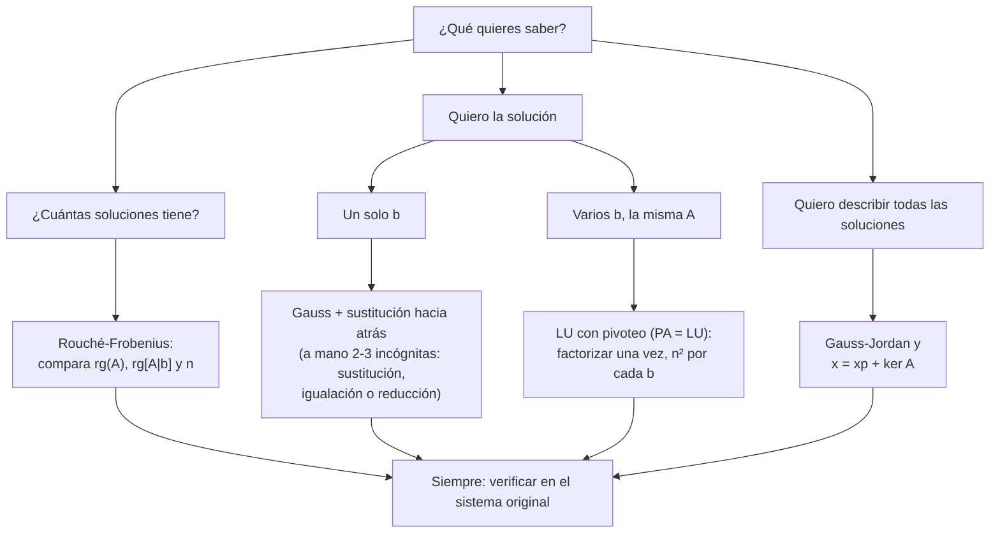

# Métodos de resolución: tabla comparativa y árbol de decisión

Guía para **elegir** qué hacer ante un problema de sistemas lineales (lección 51, y su video `ArbolDeDecisionDeMetodos`). Primero la pregunta, después el método.

---

## 1. Árbol de decisión



Versión en texto:

```
¿Qué quieres saber?
├── ¿Cuántas soluciones tiene?       →  Rouché-Frobenius (rangos)
├── Quiero la solución
│   ├── un solo b                    →  Gauss + sustitución hacia atrás
│   └── varios b con la misma A      →  LU (PA = LU)
└── Quiero describirlas todas        →  Gauss-Jordan  +  x = xp + ker A
                                         (siempre: verificar)
```

## 2. Tabla comparativa de métodos

| Método | Cuándo conviene | Qué da | Coste ($n\times n$) | Lección |
|---|---|---|---|---|
| Sustitución | 2 o 3 incógnitas, un coeficiente $1$ | solución | — | L13 |
| Igualación | variables ya despejadas | solución | — | L14 |
| Reducción | 2 o 3 incógnitas, coeficientes iguales u opuestos | solución | — | L15 |
| Gauss | un sistema, a mano o en máquina | escalonada, solución | $\approx n^3/3$ | L26 |
| Gauss-Jordan | lectura directa; infinitas soluciones; comparar sistemas | reducida, solución general | $\approx n^3/2$ | L31–L33 |
| LU / PA = LU | misma $A$, muchos $\mathbf{b}$ | $L$, $U$ ($P$) | $\approx n^3/3$ una vez + $n^2$ por $\mathbf{b}$ | L34–L38 |
| Rouché-Frobenius | solo clasificar | SCD, SCI o SI | el de calcular dos rangos | L40–L42 |
| Núcleo y espacio columna | describir la estructura | $\ker A$, $\operatorname{Col}(A)$, $\mathbf{x}_p + \ker A$ | una reducción | L45–L50 |

## 3. Pregunta ↔ herramienta

| Pregunta | Herramienta |
|---|---|
| ¿Tiene solución? | $\operatorname{rg}(A) = \operatorname{rg}[A \mid \mathbf{b}]$ |
| ¿Es única? | $\operatorname{rg}(A) = n$ (núcleo trivial) |
| ¿Cuántos parámetros libres? | $n - \operatorname{rg}(A) = \operatorname{nul}(A)$ |
| ¿Es $\mathbf{b}$ alcanzable? | $\mathbf{b} \in \operatorname{Col}(A)$ |
| ¿Son independientes unos vectores? | rango de la matriz con ellos por columnas $= $ su número |
| ¿Base del espacio generado? | columnas pivote de la matriz **original** |
| ¿Base del núcleo? | un vector por variable libre |
| Solución general | $\mathbf{x}_p + $ combinación de la base del núcleo |

## 4. Tres hábitos al terminar

1. **Verificar** en el sistema original: $A\mathbf{x} = \mathbf{b}$.
2. **Comprobar los rangos**: $\operatorname{rg}(A) + \operatorname{nul}(A) = n$.
3. **Responder en la forma pedida**: punto, recta, plano, «no hay solución».

## 5. Errores de elección frecuentes

- Resolver cuando solo se pedía clasificar.
- Repetir Gauss para cada $\mathbf{b}$ en lugar de factorizar.
- Usar Gauss-Jordan en sistemas grandes (cuesta más).
- Usar la reducida para extraer la base de $\operatorname{Col}(A)$.
- No estudiar por separado los valores críticos de un parámetro.
